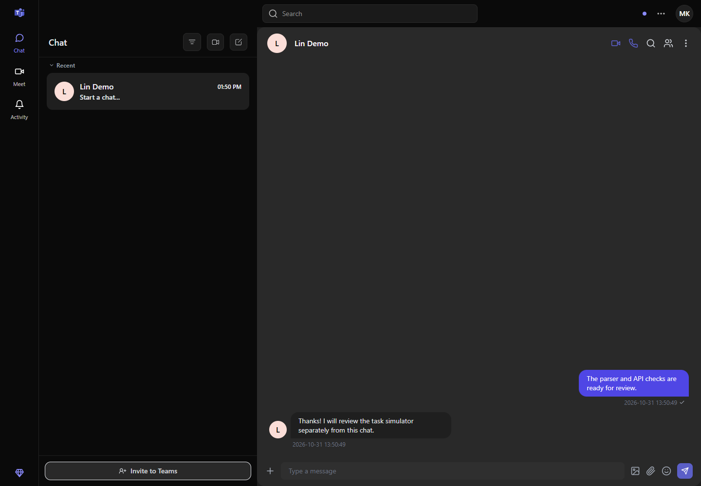
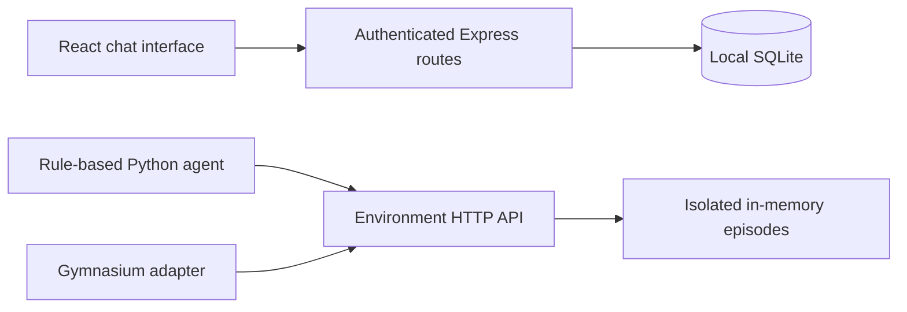

<div align="center">

# TeamsClone

**A familiar chat interface. A small playground for collaboration agents.**

Explore local direct messages, then run a Python agent through five scripted teamwork tasks. A 2025 hackathon experiment in turning everyday collaboration into an observable environment.

[](https://github.com/Muneer320/teams-clone/actions/workflows/verify.yml)
[](LICENSE)

[Try it locally](#try-it-locally) · [Run an agent](#run-an-agent) · [How-it-works guide](docs/ENVIRONMENT.md)

</div>



*The web app, with a real SQLite-backed exchange between Ada and Lin. The task simulator has its own conversations and does not operate this chat.*

## Two ways to explore

| Open the app | Exercise the simulator |
| --- | --- |
| Register two local accounts, find a contact and exchange messages. Chat polls every three seconds. | Reset an isolated episode, inspect state, send an action and observe reward and completion. |
| SQLite stores users, contacts, direct messages and activity. | A rule-based Python baseline and Gymnasium adapter make the five tasks reproducible. |
| Meet includes a local camera preview. | Greeting, channel exploration, participation, meeting invitation and social tasks have explicit completion rules. |

The original question was whether an agent could learn to navigate a collaboration app. This repository provides the environment and a **hand-written baseline**. It contains no trained policy, learning curve or measured training result.

## Try it locally

With Docker installed, from this repository:

```bash
docker compose up --build
```

Open **http://localhost:5173**. Register a disposable account; the UI's verification code is **`123456`**, a demo step that sends no email. Open another browser profile for a second account, then find that account in chat and add it as a contact. Messages persist in the `teams_data` volume.

The API health endpoint is **http://localhost:3001/health**. Compose publishes both services on loopback. Stop with `docker compose down`; that keeps the database volume.

For stable login sessions across restarts, set a long random `JWT_SECRET` in a root `.env` before starting Compose. Without it, the backend generates a fresh signing key at startup and previous sessions expire.

## Run an agent

Keep the backend running. Install Python 3.13 and the client requirements:

```bash
python -m pip install -r python_agent/requirements.txt
python rl_demo/run_demo.py --task greeting_response
python rl_demo/run_demo.py --task channel_explorer
python rl_demo/run_demo.py --task active_participant
python rl_demo/run_demo.py --task meeting_joiner
python rl_demo/run_demo.py --task social_butterfly
```

Each command creates a real API episode and prints actions, rewards and completion. The rule-based baseline completes these five tasks; this demonstrates the task contract, not learned intelligence. A backend on another port can be selected with `--url http://127.0.0.1:3031`.

Episodes reject obvious shortcuts such as switching back and forth between the same channels or repeating one message. The [environment guide](docs/ENVIRONMENT.md) explains the rules; the [Python notes](python_agent/README.md) cover the 16-value observation and 12 discrete actions.

## How it fits together



The two paths share a backend process, but they do not share users or messages. The simulator holds at most 100 episodes in memory; restart clears them. A seed selects reproducible message variants and scripted responses.

<details>
<summary><strong>Develop without Docker and run checks</strong></summary>

Use Node.js 22.12+ or 24, npm and Python 3.13. From the repository root:

```bash
npm ci
npm run install:all
npm run dev
```

This starts the frontend on 5173 and backend on 3001. Native backend configuration reads `backend/.env`; `PORT` and comma-separated `CORS_ORIGIN` can change its port and accepted browser origins. Frontend `VITE_API_URL` selects its backend base URL. SQLite is stored at `backend/data/teams_clone.db` when the backend starts in its own directory.

```bash
npm test
npm --prefix frontend run lint
npm --prefix frontend run build
python -m pip install -r python_agent/requirements.txt
python tests/smoke_api.py
python python_agent/check_env.py
```

The last two checks need the backend running on port 3001. Backend tests include cross-account contact/channel access and mutation rejection, successful owner operations, and prevention of self-assigned community administrator roles. Simulator tests cover isolation and reward shortcuts. Gymnasium's checker exercises the live HTTP adapter.

The backend development script uses Node's built-in watch mode. For dependency updates, keep its lockfile synchronized, run `npm --prefix backend audit`, and repeat the account and simulator checks.

</details>

## Prototype boundaries

Use disposable local accounts. Message routes reject sender spoofing; contact and membership operations must belong to the signed-in account. Authenticated directory search intentionally exposes other demo users' profile fields. This is not a production messaging service or a complete community permissions system.

Meet previews the local camera; it does not transmit media between users. Calendar, Settings and the hardcoded Communities pages are hidden from navigation. Some visible controls remain interface prototypes. There is no verified public deployment, distributed episode store or multi-instance database setup.

For a reproducible bug report, include the route or task, steps and expected result in [Issues](https://github.com/Muneer320/teams-clone/issues), with synthetic data and no tokens. Changes to task rules should include a shortcut/isolation test. Original team credits are retained in the [MIT license](LICENSE). This is an independent Microsoft Teams-inspired learning project, not an official Microsoft product.
